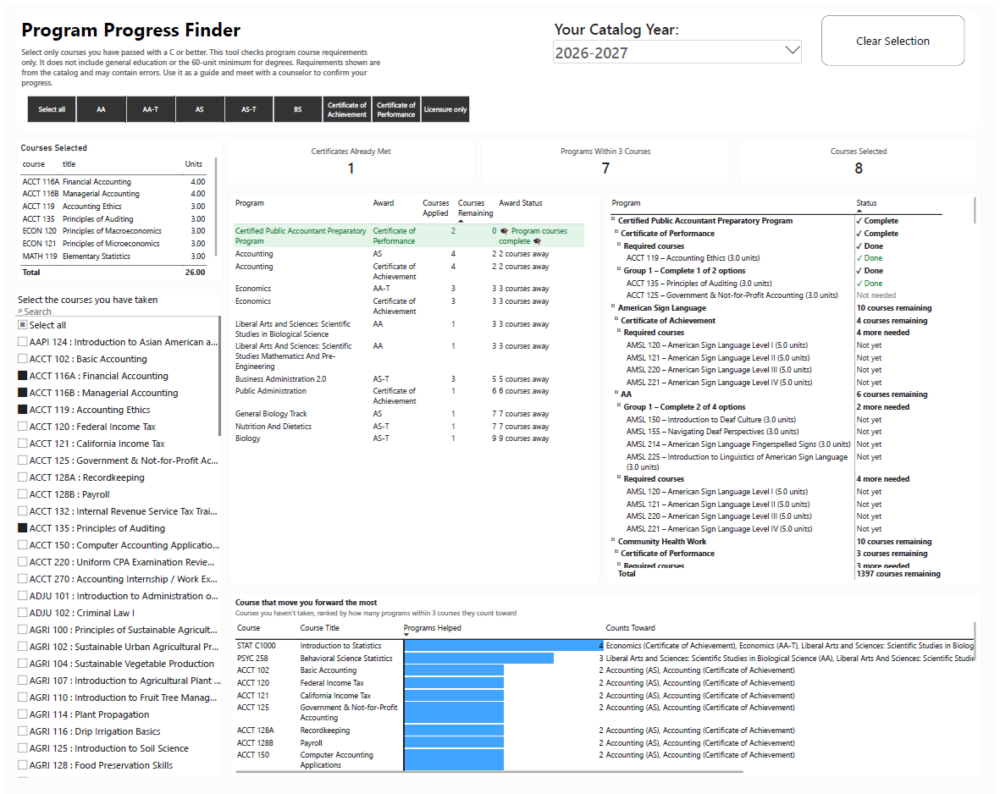

# Catalog to Excel

Turns a college catalog's program pages (PDF) into an Excel file that Power BI can use.

For every certificate and degree, it lists the courses needed, which ones are choices ("take one of these"),
which must be taken together, and how many courses or units complete each group. Each row is tagged with
its catalog year, so several years can live in one file.

Built and tested on one community college's catalogs, 2020-21 through 2026-27.



*The Power BI dashboard built on this data: pick the courses you've passed and see which programs you're closest to finishing.*

## What you need

- Python 3.10 or newer
- Two Python packages:
  ```
  pip install pandas openpyxl
  ```
- Poppler, a free tool that reads text from PDFs:
  - Windows: `conda install -c conda-forge poppler`, or download Poppler and add its `bin` folder to PATH
  - Mac: `brew install poppler`

## How to use it

1. Put the catalog PDFs in one folder. Each file name must include the catalog year, for example
   `Catalog_2023-2024.pdf`. Other PDFs in the folder are ignored.
2. Run:
   ```
   python catalog_to_excel.py "C:\path\to\Catalogs" -o Program_Requirements.xlsx
   ```
   To leave out the catalog's program descriptions (word-for-word catalog text), add `--no-description`.
3. Open `Program_Requirements.xlsx`.

You can also give it one PDF instead of a folder:
```
python catalog_to_excel.py Catalog_2026-2027.pdf -o Program_Requirements_2026-27.xlsx
```

## What's in the Excel file

| Tab | What it has |
|---|---|
| ProgramCourses | One row per program and course: its group, the group's rule, units, and choices. This is the main table for Power BI. |
| Programs | One row per program: award type, total units, whether the parsed courses match the catalog total, and notes for counselors. |
| Courses | One row per course, for a course list or slicer. |
| Review | Each program's requirements in plain language, for checking by eye. |
| ReviewFlags | Anything the parser wants a person to double-check. |
| README | How to read the tabs. |

## How it works

1. **Reads the text out of the PDF.** Poppler's `pdftotext` turns each page into plain text and keeps the
   layout, so columns and indents stay where they were. The parser relies on that spacing to tell a course
   line from a heading.
2. **Works out the catalog layout.**
   - Classic (2020-21 to 2024-25): two columns per page. The parser finds the gap between the columns on
     each page and splits them, so lines from the two columns don't get mixed.
   - META (2025-26 onward): one column, with each program heading ending in the campus name. No splitting needed.
3. **Finds each program.** It looks for award headings such as "Certificate of Achievement:" or
   "Associate in Arts for Transfer" and takes the program name from the lines that follow. Everything up to
   the next program heading belongs to that program.
4. **Finds the requirements and the total.** Within each program it finds where the course list starts
   ("Courses Required for the Major", "Requirements") and where it ends (the "Total Units" line).
5. **Sorts the lines in between.** Each line is one of:
   - a course: a code such as `ECON 120`, a title and units
   - a rule heading: "Select one course from the following", "Complete 6 units from…", which starts a new group
   - a connector: "or" (a choice) or "and" (take together)
   - noise: page numbers, footnote marks, wrapped titles and page headers, which are skipped or joined to the right line
6. **Turns each group into a rule.** The heading's wording becomes one of four rule types:
   - Required: take every course
   - Courses: take N courses from the list
   - Units: take N units from the list
   - Top-up: take whatever is needed to reach the total

   When a heading gives both a course count and a unit minimum, the unit minimum wins
   ("2 courses (minimum 6 units)" becomes 6 units).
7. **Checks its own work.**
   - It adds up the minimum units the requirements need and compares that with the catalog's Total Units.
     A mismatch is flagged and becomes a note on the program.
   - It counts the "or" and "and" words in the catalog text and checks that the same number of choices and
     pairs ended up in the data.
8. **Writes the Excel file.** One row per program and course, with the group, rule, units, choices and
   catalog year, plus the summary tabs.

### How well it works

Across seven catalogs (2020-21 to 2026-27), 1,672 of 1,679 programs add up to the catalog's own total units.
The 7 that don't were checked by hand and are inconsistencies in the catalog itself; each has a note.
Random programs from every year were also checked by hand against the PDFs.

## Limits

- Program (major) courses only. It does not include general education or the 60-unit degree minimum.
- Some catalog rules are noted but not checked, such as "a course can count toward only one group".
- Courses renamed under California's common course numbering (e.g. ENGL 101 → ENGL C1000) need a separate
  equivalents list to count across catalog years.
- Written for this college's catalog layouts. Another college's catalog would need changes.

This is an independent project, not an official college tool. The official catalog and a counselor have the final say.
